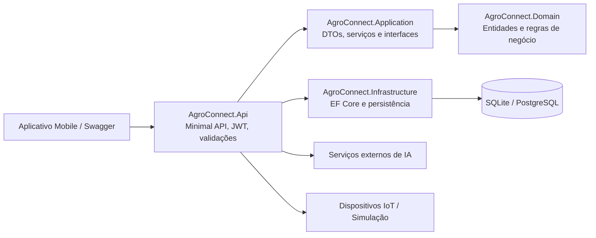

# 🌱 AgroConnect – Backend ASP.NET Core
## FIAP Global Solution – 2026/2

## 👥 Integrantes

#### NOME: Rafael Pascotte Mercadante

RM564928 - 2TDSPI

#### NOME: Rafael de Freitas Moraes

RM563210 - 2TDSPI

#### NOME: Carolina Nascimento Gonçalves

RM564786 - 2TDSPI

#### NOME: Emanuelly Ventura do Nascimento

RM562339 - 2TDSPI

#### NOME: Julia Sayuri Kina

RM564555 - 2TDSPI

---

## 📌 Descrição do Projeto

O **AgroConnect** é um projeto CitizenTech desenvolvido para ampliar o acesso de pequenos produtores rurais a informações sobre suas plantações, contribuindo para decisões mais conscientes e para o acompanhamento das condições de cultivo.

A aplicação reúne informações de propriedades, talhões, medições, dispositivos, alertas e recomendações informativas em um único ambiente, permitindo acompanhar dados relacionados à produção agrícola.

O projeto utiliza uma abordagem integrada entre desenvolvimento backend, aplicativo mobile, Internet das Coisas (IoT) e Inteligência Artificial (IA).

A demonstração utiliza dados simulados, identificados explicitamente nas respostas, permitindo validar os fluxos da aplicação sem apresentar informações simuladas como medições reais de campo.

### ODS 2 — Fome zero e agricultura sustentável

O AgroConnect se alinha ao ODS 2 da Agenda 2030 da ONU ao dar a pequenos produtores acesso, pelo celular, a informações sobre as condições de cultivo.

- **Meta 2.3 — Apoio aos pequenos produtores.** O aplicativo reúne leituras, histórico e alertas por talhão, facilitando a consulta aos dados e ajudando o produtor a decidir onde verificar as condições da plantação.
- **Meta 2.4 — Produção sustentável e práticas agrícolas resilientes.** O histórico de umidade do solo e os alertas permitem identificar períodos de baixa umidade e priorizar a inspeção de áreas com possível necessidade de irrigação.

A demonstração usa dados simulados. O projeto apresenta como esse acompanhamento pode apoiar decisões no campo. Resultados como economia de água ou aumento de produtividade ainda precisam ser avaliados com dados reais.

[ODS 2 e metas na ONU Brasil](https://brasil.un.org/pt-br/sdgs/2)

### Arquitetura

A solução utiliza uma arquitetura em camadas, separando as responsabilidades entre API, Application, Domain e Infrastructure.



### Solução Proposta

A solução permite centralizar informações relacionadas à atividade agrícola, oferecendo recursos para gerenciamento de propriedades, talhões, dispositivos, medições e acompanhamento de alertas e recomendações.

A arquitetura foi desenvolvida para permitir a integração entre o aplicativo mobile e os serviços backend, mantendo a separação de responsabilidades e possibilitando a evolução dos módulos da aplicação.

---

## 🛠️ Funcionalidades e Recursos

O AgroConnect contempla os seguintes recursos:

- Cadastro e gerenciamento de usuários.
- Autenticação e autorização utilizando JWT.
- Gerenciamento de propriedades rurais.
- Gerenciamento de talhões.
- Gerenciamento de plantios.
- Registro e consulta de medições.
- Integração com dispositivos e dados de demonstração.
- Gerenciamento de alertas.
- Registro de notificações push.
- Recomendações informativas relacionadas ao cultivo.
- Controle de acesso por proprietário.
- Proteção contra requisições duplicadas por idempotência.
- Limitação de requisições por rate limiting.
- Monitoramento da disponibilidade da API.
- Documentação interativa por Swagger.

---

## 🛠️ Tecnologias Utilizadas

- C#
- .NET 10
- ASP.NET Core Minimal API
- Entity Framework Core
- SQLite
- PostgreSQL
- JWT Bearer Authentication
- Swagger / OpenAPI
- Docker Compose
- xUnit
- Expo
- Arquitetura em camadas
- API REST

---

## 🔐 Segurança e Regras de Negócio

### Autenticação e autorização

A API utiliza autenticação JWT com assinatura HS256.

O mecanismo de autenticação contempla:

- Validação da assinatura do token.
- Validação do emissor (`Issuer`).
- Validação da audiência (`Audience`).
- Validação da expiração.
- Autorização baseada no proprietário dos recursos.
- Revogação da sessão durante o logout.

O cadastro e a autenticação são realizados pelos endpoints da API:

- `POST /api/v1/autenticacao/cadastro`
- `POST /api/v1/auth/login`

Após a autenticação, a API retorna um `accessToken`, utilizado nas requisições protegidas por meio do cabeçalho:

```http
Authorization: Bearer <accessToken>
```

O Swagger disponibiliza o botão **Authorize** para facilitar a autenticação durante os testes.

### Idempotência

A API implementa idempotência para operações de criação de propriedades, talhões, plantios e alertas.

O mecanismo garante que:

- A criação do recurso e o armazenamento da resposta aconteçam em uma única transação.
- Requisições repetidas com a mesma chave reproduzam a resposta original.
- A resposta original preserve o status `201 Created` e o cabeçalho `Location`.
- Uma mesma chave utilizada com um corpo diferente resulte em `409 Conflict`.

O aplicativo mobile já realiza criações sem cabeçalho de idempotência. Nesse cenário, requisições com o mesmo usuário, rota e corpo são deduplicadas por cinco minutos.

Clientes que precisem criar registros separados com os mesmos dados devem enviar chaves distintas.

Outras regras de consistência implementadas:

- Atualizar uma propriedade com os mesmos valores preserva sua data de atualização.
- Marcar um alerta como lido preserva o estado.
- Repetir um registro de push mantém um token por aparelho.

### Rate limiting

A API utiliza limitação de requisições para reduzir abusos e controlar o volume de chamadas.

| Tipo de operação | Limite | Janela |
| --- | --- | --- |
| Login e cadastro | 15 requisições por IP | 60 segundos |
| Demais rotas | 120 requisições por usuário autenticado ou IP | 60 segundos |

Quando o limite é excedido, a API retorna `429 Too Many Requests`, acompanhado do cabeçalho `Retry-After`.

---

## 📈 Monitoramento e Observabilidade

### Health checks

A aplicação disponibiliza endpoints para verificar sua disponibilidade e suas dependências.

| Endpoint | Finalidade |
| --- | --- |
| `GET /health` | Verifica se a API está respondendo. |
| `GET /health/ready` | Verifica o banco de dados e os serviços externos configurados. |

Quando uma dependência necessária apresenta falha, o endpoint de prontidão retorna `503 Service Unavailable`.

---

## 🧪 Testes Automatizados

O projeto utiliza **xUnit** para validar as regras de negócio e os contratos da API.

Os testes contemplam:

- Regras do domínio.
- Integração HTTP.
- Contratos utilizados pelo aplicativo mobile.
- Endpoints de saúde.
- Segurança e autenticação.
- Integração com notificações push Expo.
- Persistência relacional utilizando SQLite.

A execução da suíte automatizada é realizada na raiz da solução:

```powershell
dotnet test AgroConnect.sln
```

Os testes de integração utilizam SQLite relacional e Expo simulado, permitindo validar os fluxos sem depender de serviços externos reais.

---

## 📂 Estrutura do Projeto

A solução possui seis projetos organizados em camadas, seguindo a estrutura arquitetural utilizada no PetCore.Net.

```text
AgroConnect
│
├── AgroConnect.Api
│   ├── Endpoints
│   ├── Authentication
│   ├── Extensions
│   └── Configurações da API
│
├── AgroConnect.Application
│   ├── DTOs
│   ├── Interfaces
│   ├── Serviços de aplicação
│   └── Segurança
│
├── AgroConnect.Domain
│   ├── Entidades
│   └── Regras de negócio
│
├── AgroConnect.Infrastructure
│   ├── Repositórios EF Core
│   ├── Persistence
│   ├── Configurations
│   └── Migrations
│
├── AgroConnect.Tests.Unit
│   └── Testes das regras de domínio
│
├── AgroConnect.Tests.Integration
│   ├── Contratos Mobile
│   ├── Health Checks
│   ├── Segurança
│   └── Integração Expo
│
├── docs
│   └── INTEGRACAO_MOBILE.md
│
├── AgroConnect.sln
└── docker-compose.yml
```

### Responsabilidade dos projetos

| Projeto | Responsabilidade |
| --- | --- |
| `AgroConnect.Api` | Minimal API, endpoints, JWT, filtros, observabilidade e registro de serviços. |
| `AgroConnect.Application` | DTOs, interfaces de repositório, serviços de aplicação e segurança. |
| `AgroConnect.Domain` | Entidades e regras de negócio. |
| `AgroConnect.Infrastructure` | Repositórios EF Core, configurações de persistência e migrations. |
| `AgroConnect.Tests.Unit` | Testes das regras de domínio. |
| `AgroConnect.Tests.Integration` | Testes HTTP, contrato mobile, saúde, segurança e push Expo. |

---

## 📱 Compatibilidade e Integração com o Aplicativo Mobile

O aplicativo mobile utiliza a API do AgroConnect por meio de endpoints organizados sob o prefixo `/api/v1`.

A integração permite que o aplicativo consuma os recursos de autenticação, propriedades, talhões, medições, alertas e recomendações.

O arquivo `.env` localizado na raiz do projeto mobile deve conter as URLs utilizadas para comunicação com a API.

### Configuração das URLs

| Ambiente | URL para as duas variáveis |
| --- | --- |
| Web no mesmo computador | `http://localhost:5000/api/v1` |
| Emulador Android | `http://10.0.2.2:5000/api/v1` |
| Celular na mesma rede | `http://IP_DO_COMPUTADOR:5000/api/v1` |
| Build de entrega | URL HTTPS pública da API com `/api/v1` |

Exemplo de configuração:

```dotenv
EXPO_PUBLIC_API_URL=http://10.0.2.2:5000/api/v1
EXPO_PUBLIC_AI_API_URL=http://10.0.2.2:5000/api/v1
```

Para permitir que o celular ou emulador acesse a API, execute:

```powershell
dotnet run --project AgroConnect.Api -- --urls http://0.0.0.0:5000
```

A porta deve estar acessível na rede de desenvolvimento.

Após alterar o arquivo `.env`, reinicie o Expo.

Para consultar as rotas disponíveis e as etapas de integração, acesse:

[Guia de Integração Mobile](docs/INTEGRACAO_MOBILE.md)

---

## 🗄️ Banco de Dados e Persistência

O projeto oferece suporte a SQLite e PostgreSQL.

### SQLite

No ambiente Development, a API utiliza SQLite local e cria o banco automaticamente na primeira execução.

Essa configuração facilita o desenvolvimento e a demonstração da aplicação sem exigir a instalação de um servidor PostgreSQL.

### PostgreSQL

O projeto também permite executar a aplicação utilizando PostgreSQL por meio do Docker Compose.

O serviço publica o banco na porta `55432`, vinculada ao endereço local `127.0.0.1`.

Para iniciar o banco:

```powershell
$env:POSTGRES_PASSWORD = [Convert]::ToHexString([System.Security.Cryptography.RandomNumberGenerator]::GetBytes(24))

docker compose up -d --wait postgres
```

Configure a conexão:

```powershell
$env:ConnectionStrings__DefaultConnection = "Host=localhost;Port=55432;Database=agroconnect;Username=agroconnect;Password=$env:POSTGRES_PASSWORD"

$env:Database__ApplyMigrations = 'true'
```

Em um banco vazio, as migrations criam o schema `agroconnect`.

Se o volume do Docker Compose já existir, utilize a senha com a qual ele foi criado.

### Configuração para publicação

Em ambientes de publicação, utilize PostgreSQL e configure as seguintes variáveis:

| Variável | Finalidade |
| --- | --- |
| `ConnectionStrings__DefaultConnection` | String de conexão PostgreSQL. |
| `Jwt__Key` | Chave secreta utilizada na assinatura dos tokens JWT. |
| `Cors__Origins__0` | Primeira origem permitida para acesso cross-origin. |
| `Cors__Origins__1` | Segunda origem permitida, quando necessária. |

A chave `Jwt__Key` deve ser aleatória e possuir pelo menos 32 bytes.

As credenciais devem ser configuradas pelo gerenciador de segredos do ambiente, nunca diretamente no código-fonte ou em arquivos versionados.

Em Development, caso nenhuma chave explícita seja configurada, a API cria uma chave efêmera. Nesse cenário, os tokens deixam de funcionar após a reinicialização da aplicação.

Para publicação do Expo Web, configure as origens permitidas em `Cors__Origins__0` e nas variáveis adicionais necessárias.

---

## 🚀 Como Executar o Projeto

Siga as etapas abaixo para configurar e executar a API AgroConnect localmente.

### 1. Pré-requisitos

Antes de iniciar, verifique se possui instalado:

- .NET SDK 10.
- Visual Studio, Rider ou VS Code.
- Docker Desktop (opcional, para PostgreSQL).
- Git.

Para verificar a versão do .NET:

```powershell
dotnet --version
```

### 2. Acessar a pasta raiz da solução

```powershell
cd AgroConnect
```

### 3. Restaurar os pacotes

Execute:

```powershell
dotnet restore AgroConnect.sln
```

### 4. Executar a API

Na raiz da solução, execute:

```powershell
dotnet run --project AgroConnect.Api
```

O perfil Development inicia a aplicação na porta `5000` e cria automaticamente o banco SQLite local.

### 5. Acessar o Swagger

Após iniciar a aplicação, acesse:

[http://localhost:5000/swagger](http://localhost:5000/swagger)

O Swagger permite visualizar e testar os endpoints disponíveis.

### 6. Realizar o cadastro e autenticação

Para criar um usuário, utilize:

```http
POST /api/v1/autenticacao/cadastro
```

Depois, realize o login e copie o `accessToken` retornado.

No Swagger, clique em **Authorize** e informe o token para acessar os endpoints protegidos.

---

## 🎬 Dados para a Demonstração

O projeto disponibiliza dados demonstrativos para facilitar a apresentação e validação dos recursos.

Na primeira execução com dados de demonstração, configure as seguintes variáveis no PowerShell:

```powershell
$env:Database__SeedDemoData = 'true'

$env:Demo__Password = Read-Host 'Senha da conta demo (8 a 128 caracteres)' -MaskInput

dotnet run --project AgroConnect.Api
```

Utilize as seguintes credenciais:

| Campo | Valor |
| --- | --- |
| E-mail | `demo@agroconnect.com` |
| Senha | A senha definida durante a configuração. |

A conta demonstrativa possui:

- Uma propriedade.
- Dois dispositivos.
- Leituras válidas e leituras com falhas.
- Um alerta.
- Uma recomendação demonstrativa.

O seed é executado somente em Development e cria a conta uma única vez.

Para atualizar os horários da demonstração sem apagar os dados existentes, configure `ConnectionStrings__Sqlite` com um novo arquivo:

```powershell
$env:ConnectionStrings__Sqlite = 'Data Source=agroconnect-demo-video.db;Foreign Keys=True'

$env:Database__SeedDemoData = 'true'

dotnet run --project AgroConnect.Api
```

---

## 📋 Itens da Avaliação

O projeto contempla os requisitos técnicos da disciplina Advanced Business Development with .NET.

| Item | Implementação |
| --- | --- |
| Minimal API e Swagger | Rotas organizadas em `/api/v1`, DTOs de entrada e saída, validações, erros em português e documentação interativa com JWT. |
| JWT | Assinatura HS256, validação de emissor, audiência e expiração, autorização por proprietário e revogação da sessão no logout. |
| Idempotência | Criação de recursos e armazenamento da resposta em uma única transação, reprodução de respostas e tratamento de conflitos. |
| Rate limiting | Limitação de requisições por IP e usuário autenticado, com retorno `429` e `Retry-After`. |
| xUnit | Testes de regras do domínio e testes de integração HTTP utilizando SQLite relacional e Expo simulado. |
| Health checks | Verificação da disponibilidade da API, banco de dados e serviços externos configurados. |

---

## 🌐 Link do Deploy

**API AgroConnect – Render**

[https://gs-dotnet-8wmg.onrender.com](https://gs-dotnet-8wmg.onrender.com)

**Swagger:**

[https://gs-dotnet-8wmg.onrender.com/swagger](https://gs-dotnet-8wmg.onrender.com/swagger)

---

## 📚 Documentação Complementar

Para mais informações sobre a integração entre o backend e o aplicativo mobile, consulte:

- [Guia de Integração Mobile](docs/INTEGRACAO_MOBILE.md)

